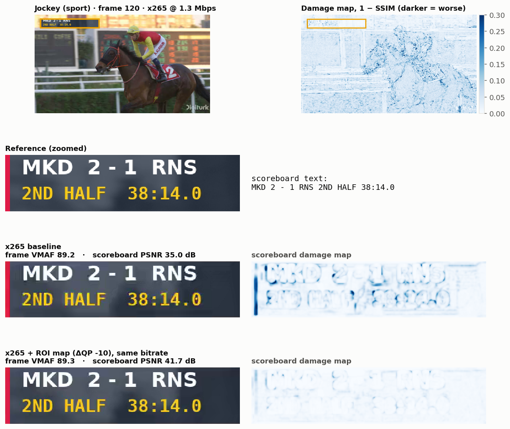
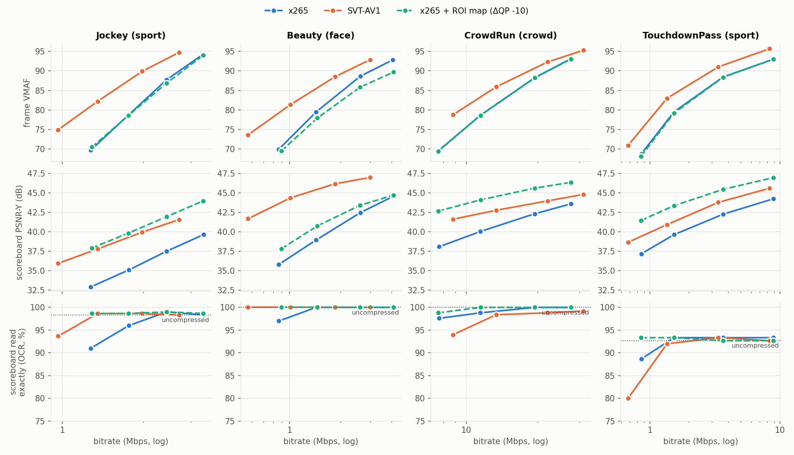
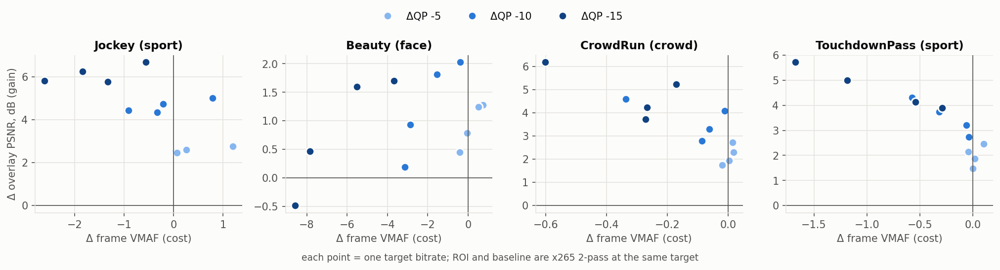

# Frame vs ROI video quality: scoreboard and face degradation in x265 and SVT-AV1

PSNR, SSIM and VMAF average a whole picture into one number. In a sports broadcast, though, the parts
viewers actually read are small: the scoreboard here covers about 3 % of a 1080p frame, and a face in
a wide shot even less. I wanted to check whether frame-level metrics notice when an encoder, or a
tuning choice, changes those regions, and whether a simple region-of-interest (ROI) map can help,
both to measure the region and to give it more bits at the same bitrate.

To test this, I took four 5-second 1080p clips (horse racing, a face close-up, a marathon crowd and
American football), burned a semi-transparent scoreboard with a running clock into each, and encoded
them with x265 and SVT-AV1 at four bitrates. I measured quality on the whole frame and on the
scoreboard and face regions separately, checked with OCR whether the scoreboard stayed readable, and
tried ROI encoding in x265 through FFmpeg's `addroi` filter at three strengths. In total: 176 encodes
and 44 000 measured frames, run with one command (`./run.sh`) from one file (`config.yaml`).

**Observations:**

* The frame score barely registers region differences. Two x265 encodes at the same bitrate score
  89.2 and 89.3 in frame VMAF while their scoreboards differ by 6.7 dB in PSNR. SVT-AV1's BD-rate
  against x265 on Jockey is −30 % by frame VMAF and −47 % by scoreboard PSNR. Frame SSIM also gives
  −47 % on that clip, though, so the choice of metric matters about as much as the region.
* Scores that ignore the ROI, including a "local" 5th-percentile block SSIM, do not register the
  scoreboard gain from ROI encoding. ROI-weighted pooling does, which is expected since it weights
  the region; the frame metrics, for their part, correctly see a slightly worse background. Which of
  the two matches viewers better would need a subjective test, which I did not run. Measuring the
  region directly is cheap: VMAF on the scoreboard costs 1.9 ms per frame against 86.6 ms for frame
  VMAF.
* With the ROI limited to the scoreboard, a static map at ΔQP −10 raises scoreboard PSNR by 2.7 to
  5.0 dB at the same bitrate, for at most 1.8 % frame-VMAF BD-rate. It costs much more when the ROI is
  large (+15.6 % on the close-up), and a static map cannot follow moving faces. A per-frame map with
  SVT-AV1 helps faces on Jockey and CrowdRun, but results are mixed on the close-up.

All numbers come from [`results/REPORT.md`](results/REPORT.md), which the pipeline generates.


*Same frame, same bitrate, frame VMAF 89.2 vs 89.3: x265 without (middle) and with (bottom) an ROI map.*

---

## The problem

Encoders are tuned and compared with frame-level metrics: PSNR, SSIM, VMAF. Each one averages a
whole picture into one number. In live sport, what viewers look at is often small, so a codec or a
tuning choice can change those regions a lot while the frame average barely moves. If that happens,
two things go wrong:

* **Measurement.** Quality monitoring and codec comparisons (BD-rate) report a number that does not
  describe the regions that matter.
* **Encoding.** The encoder spends bits where the average says they help most, which is usually
  textured background (crowds, grass), not graphics or faces.

## Why it matters

Sport is where this hurts most: overlaid graphics are on screen all the time, they carry information
(score, clock), and their sharp text edges are exactly what block-based coding damages first. If frame
metrics hide this, encoder decisions made on them can be quietly wrong. The fix should be cheap: a
broadcaster knows where its own graphics are, and a light face detector runs in real time.

## What I did

1. **Content.** Four 5-second 1080p clips: Jockey (horse racing, fast pan), Beauty (face close-up),
   CrowdRun (dense crowd), TouchdownPass (American football). A broadcast-style scoreboard is burned in
   with FFmpeg: two rows, 70 % opaque so the moving background shows through, and a game clock running
   in tenths. Its text is known for every frame.
2. **Encoding.** x265 (`medium`, 2-pass ABR) and SVT-AV1 (preset 6, VBR) through FFmpeg, at 4 bitrates
   per clip chosen by a pilot so that frame VMAF spans about 70 to 94.
3. **Measuring three ways.**
   * *Frame*: VMAF, PSNR-Y, SSIM, XPSNR.
   * *Region*: VMAF, PSNR and SSIM on the scoreboard crop and on face boxes from OpenCV's YuNet detector,
     plus OCR of the scoreboard on every frame, scored against the known text. OCR is a
     "can you still read it" check that no codec is tuned for.
   * *Pooling*: one SSIM map per frame, pooled as the mean, the 5th percentile of 64×64 blocks (a
     "local-aware" pooling), and ROI-weighted (50 % ROI, 50 % background). The compute cost of each
     is timed.
4. **ROI encoding.** The ROI map (scoreboard box plus faces) is fed to x265 through FFmpeg's `addroi`
   filter as a negative QP offset, so the region gets more bits at the same 2-pass bitrate target.
   Three strengths are swept: ΔQP −5, −10, −15.
5. **Extension: moving faces.** `addroi` is static for a whole clip, so it cannot follow faces. A
   per-frame map is tested with SVT-AV1's own encoder app (`--roi-map-file`), against a static map.
6. **Checks.** Repeat encodes give a noise floor (x265 is bit-exact; SVT-AV1 varies ±1.9 % in
   bitrate). BD-rates use measured bitrates and report how much the curves overlap. The metric code is
   cross-checked against libvmaf (region PSNR matches to 0.0000 dB).

Design choices and the pitfalls found on the way are in [`DESIGN.md`](DESIGN.md).

---

## Results

### 1. The frame score barely tells apart encodes whose scoreboards differ, and the codec comparison depends on what you measure

* At the same frame VMAF, SVT-AV1's scoreboard is +4.3 dB (Beauty), +1.8 dB (Jockey), +1.0 dB
  (CrowdRun) and +0.5 dB (TouchdownPass) cleaner than x265's in PSNR, while frame PSNR differs by less
  than 0.6 dB.
* Within one codec it is starker. In Figure 2, x265 with and without an ROI map scores frame VMAF 89.2
  vs 89.3, but the scoreboard is 35.0 vs 41.7 dB.
* BD-rate of SVT-AV1 vs x265 on Jockey is −30 % by frame VMAF and −47 % by scoreboard PSNR
  (TouchdownPass: −34 % vs −45 %). Frame SSIM gives −47 % on Jockey too, so part of this spread comes
  from the metric rather than the region. On CrowdRun it is −7 % by frame PSNR, −20 % by frame VMAF and
  +10 % by 5th-percentile block SSIM, so even the sign depends on the pooling.
* What I did not find is outright collapse. Scoreboard VMAF was at or above frame VMAF in all 32
  baseline encodes. OCR misread the scoreboard (on a frame the uncompressed video reads correctly) in at
  most 1.5 % of the frames with frame VMAF ≥ 80. Static, high-contrast text is cheap to code. The damage
  is real, but it shows up as *differences between encodes*, not as unreadable graphics.

### 2. Which scores register the scoreboard change at equal bitrate

x265 encodes with and without an ROI map were paired at the same 2-pass target, 48 pairs in all. The
scoreboard improves in 47 of them (+0.2 to +6.7 dB), paid for by a slightly worse background. On those
47 pairs, the ROI encode is called better by:

| metric | frame VMAF | frame PSNR | XPSNR | SSIM mean | SSIM 5th-pct block | SSIM ROI-weighted |
|:--|--:|--:|--:|--:|--:|--:|
| agrees with the scoreboard gain | 28 % | 6 % | 11 % | 2 % | 0 % | 87 % |
| rank correlation with scoreboard PSNR, same bitrate | −0.68 | −0.81 | −0.79 | −0.84 | −0.85 | +0.53 |

Pooling that is local but knows nothing about content finds the worst *texture* blocks (crowd, grass,
hair), not the graphic. ROI-weighted pooling sees the scoreboard gain, but that is partly by
construction, since it gives the region half the weight. The frame metrics are not simply wrong here:
they correctly see the background getting slightly worse. Which trade-off viewers prefer is a question
for a subjective test. On cost, ROI-weighted pooling adds about 3 ms per frame on top of the SSIM map,
and VMAF on the scoreboard alone costs 1.9 ms against 86.6 ms for frame VMAF (compute-cost table
below).

### 3. A static ROI map improves the scoreboard at small cost when the region is small, but cannot follow faces

* On the three clips where the ROI is just the scoreboard (3 % of the frame), ΔQP −10 raises scoreboard
  PSNR by +2.7 to +5.0 dB at the same bitrate (rate error ≤ 1.1 %). Frame VMAF moves by −0.9 to +0.8.
* In BD-rate terms, the scoreboard needs 50–72 % fewer bits for a frame-VMAF cost of +0.4 to +1.8 %.
  ΔQP −5 costs nothing on frame VMAF (BD-rate −1.7 % to 0.0 %) and still saves 31–50 % on the
  scoreboard.
* At the lowest bitrate it restores legibility: Jockey OCR exact-read goes from 91 % to 99 %
  (uncompressed: 98 %), and TouchdownPass from 89 % to 93 % (= uncompressed).
* Limits. On the close-up (Beauty, ROI = 39 % of the frame) the same ΔQP costs +15.6 % frame-VMAF
  BD-rate. Moving faces never enter a static map, so they *lose* bits: face PSNR BD-rate +7 % on Jockey
  and +8 % on TouchdownPass.
* A per-frame map (SVT-AV1 extension) helps there: face PSNR BD-rate −5 to −8 % on Jockey and −10 to
  −12 % on CrowdRun, against +0.5 to +2.3 % for the static map, for at most 1.1 % frame-VMAF cost. On
  TouchdownPass the gain is small (−1 to −3 %), since faces are rare under helmets. On Beauty it is
  mixed: −6.6 % at qindex offset −24, but +4.9 % at −48, where the face covers so much of the frame
  that the stronger offset no longer helps.

One observation that does not fit the averages (one clip, single SVT-AV1 run, so treat it as a lead):
at the lowest TouchdownPass bitrate, SVT-AV1 beats x265 on frame VMAF (70.9 vs 68.7) *and* on
scoreboard PSNR (38.7 vs 37.2 dB), yet OCR reads its scoreboard exactly in only 80 % of frames, against
89 % for x265 and 93 % uncompressed. CrowdRun shows the same pattern (94 % vs 98 %).

### Figures

**Figure 1. Rate-distortion, frame vs scoreboard.** The ROI map (dashed) leaves the frame curve where
it was and lifts the scoreboard curve, at times above SVT-AV1.


**Figure 2** (shown at the top). Jockey frame 120 (an I-frame), x265 at 1.3 Mbps. The baseline rings
around every glyph and the ROI map removes it, yet frame VMAF reads 89.2 vs 89.3. This is the largest
scoreboard gain among frames with matched frame VMAF ≥ 80, so it is the clearest case, not a typical
one.

**Figure 3. ROI trade-off per strength** (x265, ROI minus baseline; each point is one bitrate).


The ROI map of each clip is shown in [`fig0_roi_maps.png`](results/figures/fig0_roi_maps.png).

### Frame vs region at the second bitrate rung

| clip | encode | Mbps | frame VMAF | frame PSNR | scoreboard PSNR | scoreboard VMAF | face PSNR | OCR exact % (uncompr.) |
|:--|:--|--:|--:|--:|--:|--:|--:|--:|
| Jockey | x265 | 1.76 | 78.8 | 36.9 | 35.1 | 85.3 | 33.5 | 96.0 (98.3) |
| Jockey | x265 + ROI (ΔQP −10) | 1.76 | 78.6 | 36.8 | **39.8** | 95.8 | 33.2 | 98.7 |
| Jockey | SVT-AV1 | 1.35 | 82.2 | 38.0 | 37.8 | 87.8 | 35.2 | 98.7 |
| Beauty | x265 | 1.44 | 79.5 | 37.3 | 38.9 | 92.7 | 38.3 | 100 (100) |
| Beauty | x265 + ROI (ΔQP −10) | 1.46 | 77.9 | 36.6 | 40.8 | 94.2 | **39.4** | 100 |
| Beauty | SVT-AV1 | 1.01 | 81.3 | 37.6 | 44.4 | 96.7 | 39.1 | 100 |
| CrowdRun | x265 | 11.47 | 78.6 | 30.3 | 40.0 | 92.0 | 31.5 | 98.8 (100) |
| CrowdRun | x265 + ROI (ΔQP −10) | 11.49 | 78.6 | 30.3 | **44.1** | 95.4 | 31.5 | 100 |
| CrowdRun | SVT-AV1 | 13.39 | 85.9 | 31.4 | 42.8 | 95.5 | 32.5 | 98.4 |
| TouchdownPass | x265 | 1.53 | 79.5 | 35.1 | 39.6 | 91.6 | 31.0 | 93.3 (92.7) |
| TouchdownPass | x265 + ROI (ΔQP −10) | 1.53 | 79.2 | 35.1 | **43.4** | 95.5 | 30.8 | 93.3 |
| TouchdownPass | SVT-AV1 | 1.35 | 83.0 | 35.8 | 40.9 | 93.4 | 31.4 | 92.0 |

Same target per clip. SVT-AV1's VBR misses its target by −36 % to +12 %, so compare it by BD-rate
(REPORT §1), not row by row. Face PSNR uses the per-frame detector boxes. The lowest rung is in
[`results/tables/readme_rung1.md`](results/tables/readme_rung1.md).

### Metric compute cost

CPU time (user + sys) on one thread, per 1080p frame, net of decoding, mean of the 4 clips
([`results/tables/timing.md`](results/tables/timing.md)):

| what is computed | CPU ms per frame |
|:--|--:|
| frame VMAF (libvmaf v0.6.1) | 86.6 |
| frame XPSNR (FFmpeg) | 12.4 |
| frame SSIM, frame PSNR (FFmpeg, SIMD) | < 1 (below the ±1 ms run-to-run noise) |
| scoreboard VMAF (640×96 crop) | 1.9 |
| full-resolution SSIM map (Python / OpenCV, unoptimised) | 52.7 |
| + mean pooling | 0.7 |
| + ROI-weighted pooling | 3.1 |
| + 5th-percentile block pooling | 3.9 |

Measuring the region directly is cheap: VMAF on the scoreboard costs about 1/45 of frame VMAF.

---

## Reproduce

```bash
./run.sh                    # the whole study, detached (setsid + nohup); log: logs/run_latest.log
./run.sh analyze figures    # re-run some stages (finished work is skipped)
./run.sh --clips beauty     # a subset of clips
python3 tests/test_core.py  # sanity tests: BD-rate, SSIM, block pooling, OCR error rate
```

**Requirements** (tested on Debian 13): FFmpeg ≥ 7.1 built with libvmaf, libx265 and libsvtav1;
Python 3 with numpy, scipy, pandas, matplotlib, opencv-python (≥ 4.8, for YuNet), PyYAML and
tabulate; tesseract with the `eng` model; 7z and curl. The per-frame-map extension also needs
`SvtAv1EncApp`, built from the same SVT-AV1 version as FFmpeg's library (cmake, nasm, gcc; about 2 min):

```bash
mkdir -p store/build && cd store/build
curl -L https://gitlab.com/AOMediaCodec/SVT-AV1/-/archive/v3.1.2/SVT-AV1-v3.1.2.tar.gz | tar xz
cmake -S SVT-AV1-v3.1.2 -B svt-build -DCMAKE_BUILD_TYPE=Release -DBUILD_DEC=OFF -DBUILD_TESTING=OFF -DBUILD_SHARED_LIBS=OFF
cmake --build svt-build -j 10      # -> SVT-AV1-v3.1.2/Bin/Release/SvtAv1EncApp
```

**Pipeline stages:** `prepare` (download, cut, overlay, lossless FFV1 reference) → `roi` (YuNet + map)
→ `pilot` (per-clip bitrates) → `encode` → `svtroi` (extension) → `metrics` → `timing` → `analyze`
→ `figures`. A full run takes about 2 hours on a 20-core machine.

**Storage.** Every large file goes under `store/` (references 1.3 GB, bitstreams 0.8 GB). Run
`rm -rf store/` to free it all; `./run.sh` rebuilds it. Every stage checks the project size (warning at
3 GB, stop at 5 GB); a full run peaks at about 2.4 GB. UVG archives are deleted once the reference is
written, and Xiph clips are streamed, never stored.

**Data.** Source clips are downloaded from the [UVG dataset](https://ultravideo.fi/dataset.html)
(Jockey, Beauty) and the [Xiph.org test media](https://media.xiph.org/video/derf/) (crowd_run,
touchdown_pass). They are not redistributed here; see their sites for terms of use.

```
config.yaml   every parameter: clips, overlay, bitrate ladders, ROI strengths, metric settings
run.sh        one command
hia/          the pipeline ("hidden in the average"), one module per stage (+ bdrate.py, common.py)
tests/        sanity tests
results/      small outputs: REPORT.md, encodes.csv, tables/, figures/, roi/, pilot.json
store/        large and regenerable (git-ignored): refs/, bitstreams/, models/, build/
DESIGN.md     design choices, tool behaviour verified before use, pitfalls found while building
```

---

## Limitations

* **No subjective test.** OCR legibility is a task proxy, not a viewer rating, and Tesseract tolerates
  blur, so it under-reports damage that people would notice. Region VMAF is a full-frame model applied
  to 640×96 crops: an uncompressed crop already scores 97.9, not 100, and it reads higher than region
  PSNR. Where they disagree, the conclusions rely on region PSNR and OCR.
* **Small clip set.** 4 clips × 5 s, one resolution, 8-bit SDR, one preset per encoder. Beauty is a
  close-up, so its ROI is 39 % of the frame and behaves differently. Faces are rare in TouchdownPass
  (helmets).
* **Synthetic overlay.** One static, well-aligned, high-contrast scoreboard. Real graphics animate,
  scroll, fade and sit anywhere. Knowing the box exactly also makes it a perfect ROI, which no detector
  gives you.
* **ROI tooling.** `addroi` is static for a whole clip. The SVT-AV1 extension runs in CRF mode, because
  under VBR its rate control undid the map on a test clip. Its numbers are BD-rates against its own
  baseline and are not comparable with the x265 ROI numbers.
* **Rate control.** SVT-AV1 VBR missed its targets by −36 % to +12 % and is not bit-exact between runs.
  BD-rates use measured bitrates. Some region BD-rates rest on partly overlapping curves (overlap
  column in REPORT §1); Beauty's and CrowdRun's scoreboard BD-rates have overlap < 0.3 and are left
  out of the findings.

---

## Next steps

* **A subjective check**: a small pairwise test on the scoreboard and face crops, to see whether region
  PSNR or OCR tracks what viewers notice.
* **Real graphics**: animated, scrolling and fading overlays, detected rather than known, e.g. with a
  text or logo detector, so the ROI map is no longer perfect.
* **A learned, region-aware metric**: frame VMAF with ROI-weighted pooling of its feature maps, checked
  against the equal-bitrate ranking test used here.
* **Dynamic ROI in the encoder at a fixed bitrate**: a per-frame map with x265 (through the library API)
  or SVT-AV1 under rate control, rather than CRF.

## References

* Z. Wang, A. C. Bovik, H. R. Sheikh, E. P. Simoncelli, "Image quality assessment: from error
  visibility to structural similarity," *IEEE Trans. Image Processing*, 2004. (SSIM)
* Z. Li et al., "Toward a practical perceptual video quality metric," Netflix Technology Blog, 2016.
  (VMAF)
* C. R. Helmrich et al., "XPSNR: a low-complexity extension of the perceptually weighted peak
  signal-to-noise ratio for high-resolution video quality assessment," *ICASSP*, 2020.
* G. Bjøntegaard, "Calculation of average PSNR differences between RD-curves," ITU-T VCEG-M33, 2001.
  (BD-rate)
* W. Wu, H. Peng, S. Yu, "YuNet: a tiny millisecond-level face detector," *Machine Intelligence
  Research*, 2023.
* A. Mercat, M. Viitanen, J. Vanne, "UVG dataset: 50/120fps 4K sequences for video codec analysis and
  development," *ACM MMSys*, 2020.
